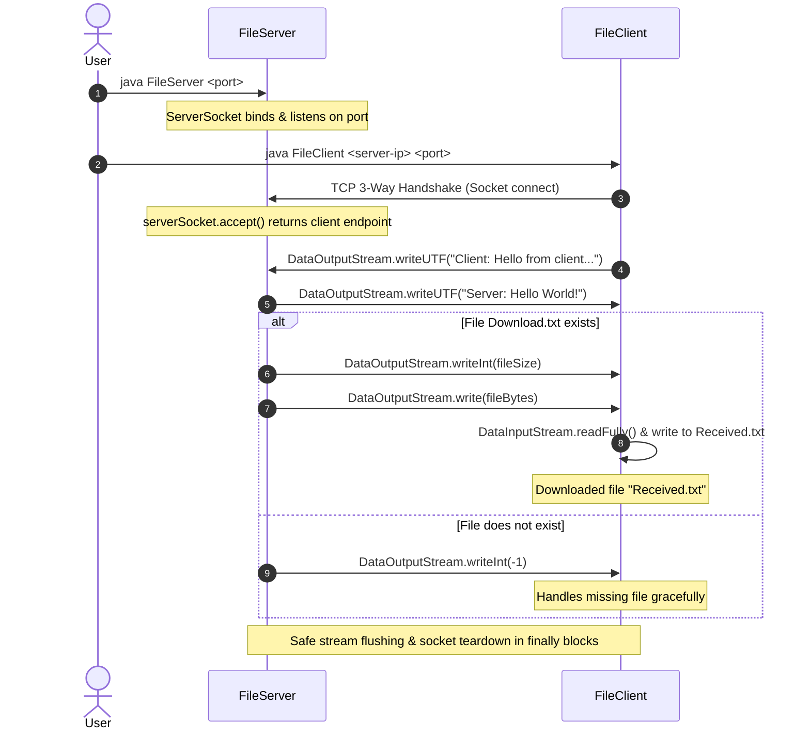

# FileTransfer-CSNETWK

> **CSNETWK (Computer Networks) — Lab Activity 3: Socket Programming (Task 1)**  
> **Authors:** Dana Louise A. Guillarte & Chrysille Grace L. So

---

## 📌 Project Overview

**FileTransfer-CSNETWK** is a client-server socket communication application built using standard Java networking (`java.net.*`) and I/O streams (`java.io.*`). 

The application establishes a TCP connection between a server and a client endpoint over a configurable port, performs a bi-directional handshake exchange, and transmits a binary/text file (`Download.txt`) from the server to the client, where it is written locally as `Received.txt`.

---

## 🖥️ Front-End Assessment

- **Current Implementation:** Pure **Command-Line Interface (CLI) / Console Application**.
- **Front-End Present:** **No** (No Swing, JavaFX, AWT, or Web/HTML frontend).
- **Course Specification:** In accordance with the CSNETWK Lab Activity 3 specification (*"Threading and GUI are not required for this activity"*), the system is strictly terminal-driven for protocol verification and socket lifecycle observation.

---

## 🔄 Protocol & Communication Flow



---

## 🛠️ Error Handling & Improvements Implemented

1. **CLI Argument Validation**:
   - `FileServer` validates that a port number argument is provided and properly formatted as an integer, outputting clear usage instructions if missing (`Usage: java FileServer <port>`).
   - `FileClient` validates both the server host/IP address and port arguments (`Usage: java FileClient <server-ip> <port>`).
2. **Missing File Protocol Signaling**:
   - Resolved potential `EOFException` crashes where an absent `Download.txt` on the server would cause the client to wait indefinitely or crash upon socket closure. The server now signals file status (`-1` code) before closing.
3. **Safe Resource Management**:
   - Sockets and streams are safely isolated and closed within `try-with-resources` and `finally` blocks, preventing socket descriptor leaks and `BindException` on immediate restarts.
4. **Complete Byte Stream Read**:
   - File reading on both ends guarantees complete transfer of bytes without partial stream truncation.

---

## 📂 Project Folder Hierarchy

### Project Folder Hierarchy
The project implements a clean, modular structure under `src/main/java/` with dedicated `data/` and `docs/` directories, while retaining backward compatibility for direct root-level execution:

```text
FileTransfer-CSNETWK/
├── .gitignore
├── README.md
├── pom.xml                                   # Maven project descriptor
├── docs/                                     # Documentation, specs, and screenshots
│   ├── CSNETWK_Lab03_GuillarteSo.png         # Execution proof screenshot
│   └── Lab Activity 3 - Socket Programming (Task 1).pdf # Lab specification
├── data/                                     # Dedicated data directories
│   ├── server/
│   │   └── Download.txt                      # Source file served by server
│   └── client/
│       └── Received.txt                      # Output file downloaded by client
├── src/                                      # Modular source code
│   └── main/
│       └── java/
│           └── edu/dlsu/csnetwk/
│               ├── common/
│               │   └── ProtocolConfig.java   # Centralized protocol configuration
│               ├── server/
│               │   ├── FileServer.java       # Server endpoint & listener
│               │   └── ClientHandler.java    # Connection & transmission handler
│               └── client/
│                   └── FileClient.java       # Client receiver implementation
├── FileServer.java                           # Root compatibility entrypoint
├── FileClient.java                           # Root compatibility entrypoint
├── Download.txt                              # Root fallback source file
└── Received.txt                              # Root fallback output file
```

---

## 🚀 How to Run

### Prerequisites
- **Java Development Kit (JDK) 8 or higher** (Tested on OpenJDK 23).

---

### Option A: Running the Modular Package (Recommended)

#### 1. Compile the Source Code
Compile all modular classes into `bin/`:
```powershell
javac -d bin (Get-ChildItem -Path src -Filter *.java -Recurse | ForEach-Object { $_.FullName })
```

#### 2. Start the Modular Server
Run the modular server with the listening port (e.g., `4000`):
```powershell
java -cp bin edu.dlsu.csnetwk.server.FileServer 4000
```

#### 3. Run the Modular Client
In a separate terminal, connect to the server:
```powershell
java -cp bin edu.dlsu.csnetwk.client.FileClient 127.0.0.1 4000
```

---

### Option B: Running via Root Entrypoints (Lab Submission Mode)

#### 1. Compile the Root Files
```powershell
javac FileServer.java FileClient.java
```

#### 2. Start the Server
```powershell
java FileServer 4000
```

#### 3. Run the Client
```powershell
java FileClient 127.0.0.1 4000
```

*Expected Client Output:*
```text
Client: Connecting to server at localhost/127.0.0.1:4000
Client: Connected to server at/127.0.0.1:4000
Server: Hello World!
Client: Downloaded file "Received.txt"
Client: Connection is terminated.
```

*Expected Server Output Upon Connection:*
```text
Server: New client connected: /127.0.0.1:<ephemeral-port>
Client: Hello from client/127.0.0.1:<ephemeral-port>
Server: Sending file "Download.txt" (12 bytes)
Server: Connection is terminated.
```
