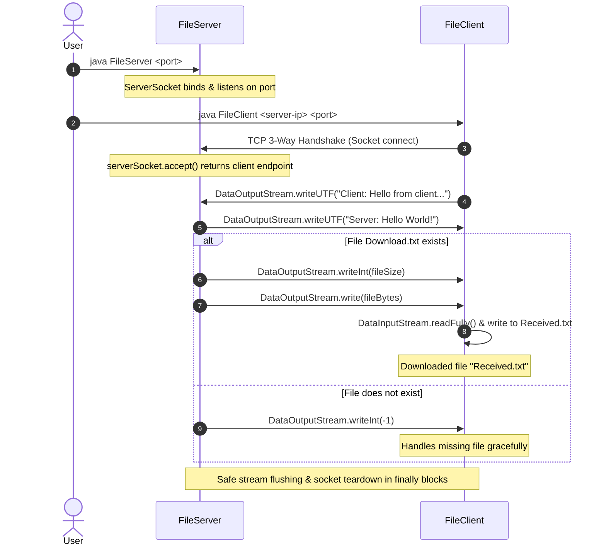

# FileTransfer-CSNETWK

> **CSNETWK (Computer Networks) — Lab Activity 3: Socket Programming (Task 1)**  
> **Authors:** Dana Louise A. Guillarte & Chrysille Grace L. So

---

## 📌 Project Overview

**FileTransfer-CSNETWK** is a client-server socket communication application built using standard Java networking (`java.net.*`) and I/O streams (`java.io.*`). 

The application establishes a TCP connection between a server and a client endpoint over a configurable port, performs a bi-directional handshake exchange, and transmits a binary/text file (`Download.txt`) from the server to the client, where it is written locally as `Received.txt`.

---

## 🖥️ Front-End Assessment

- **Current Implementation:** Pure **Command-Line Interface (CLI) / Console Application**.
- **Front-End Present:** **No** (No Swing, JavaFX, AWT, or Web/HTML frontend).
- **Course Specification:** In accordance with the CSNETWK Lab Activity 3 specification (*"Threading and GUI are not required for this activity"*), the system is strictly terminal-driven for protocol verification and socket lifecycle observation.

---

## 🔄 Protocol & Communication Flow



---

## 🛠️ Error Handling & Improvements Implemented

1. **CLI Argument Validation**:
   - `FileServer` validates that a port number argument is provided and properly formatted as an integer, outputting clear usage instructions if missing (`Usage: java FileServer <port>`).
   - `FileClient` validates both the server host/IP address and port arguments (`Usage: java FileClient <server-ip> <port>`).
2. **Missing File Protocol Signaling**:
   - Resolved potential `EOFException` crashes where an absent `Download.txt` on the server would cause the client to wait indefinitely or crash upon socket closure. The server now signals file status (`-1` code) before closing.
3. **Safe Resource Management**:
   - Sockets and streams are safely isolated and closed within `try-with-resources` and `finally` blocks, preventing socket descriptor leaks and `BindException` on immediate restarts.
4. **Complete Byte Stream Read**:
   - File reading on both ends guarantees complete transfer of bytes without partial stream truncation.

---

## 📂 Project Folder Hierarchy

### Current Flat Hierarchy (Lab Submission Compatible)
The project is currently structured for single-directory CLI execution as required by academic grading scripts:
```text
Socket-Programming-1/
├── .gitignore                                 # Git ignore patterns for build/class artifacts
├── CSNETWK_Lab03_GuillarteSo.png              # Execution proof screenshot
├── Download.txt                               # Source file to be transferred by server
├── FileClient.java                            # TCP client implementation
├── FileServer.java                            # TCP server implementation
├── Lab Activity 3 - Socket Programming (Task 1).pdf # Assignment specification
├── README.md                                  # Project documentation
└── Received.txt                               # Destination file created by client
```

### Recommended Production / Modular Hierarchy
For scalable development, testing, and multi-platform packaging, the following folder hierarchy is recommended:

```text
FileTransfer-CSNETWK/
├── .gitignore
├── README.md
├── pom.xml (or build.gradle)                 # Build management
├── docs/
│   ├── CSNETWK_Lab03_GuillarteSo.png          # Execution screenshots & logs
│   └── specifications.pdf                     # Lab/Course requirements
├── data/
│   ├── server/
│   │   └── Download.txt                       # Server storage directory
│   └── client/
│       └── Received.txt                       # Client download output directory
├── src/
│   └── main/
│       └── java/
│           └── edu/dlsu/csnetwk/
│               ├── common/                    # Shared network constants & protocols
│               │   └── ProtocolConfig.java
│               ├── server/                    # Server logic & connection workers
│               │   ├── FileServer.java
│               │   └── ClientHandler.java
│               └── client/                    # Client logic & file downloaders
│                   └── FileClient.java
└── bin/                                       # Compiled bytecode outputs
```

---

## 🚀 How to Run

### Prerequisites
- **Java Development Kit (JDK) 8 or higher** (Tested on OpenJDK 23).

### Step 1: Compile the Source Files
Open a terminal in the project directory:
```powershell
javac FileServer.java FileClient.java
```

### Step 2: Ensure Source File Exists
Ensure `Download.txt` exists in the working directory:
```powershell
echo "Hello World!" > Download.txt
```

### Step 3: Start the File Server
Run the server with the desired port (e.g., `4000`):
```powershell
java FileServer 4000
```
*Expected Server Output:*
```text
Server: Listening on port 4000...
```

### Step 4: Run the File Client
In a separate terminal window, run the client with the server IP and port:
```powershell
java FileClient 127.0.0.1 4000
```

*Expected Client Output:*
```text
Client: Connecting to server at localhost/127.0.0.1:4000
Client: Connected to server at/127.0.0.1:4000
Server: Hello World!
Client: Downloaded file "Received.txt"
Client: Connection is terminated.
```

*Expected Server Output Upon Connection:*
```text
Server: New client connected: /127.0.0.1:<ephemeral-port>
Client: Hello from client/127.0.0.1:<ephemeral-port>
Server: Sending file "Download.txt" (12 bytes)
Server: Connection is terminated.
```
